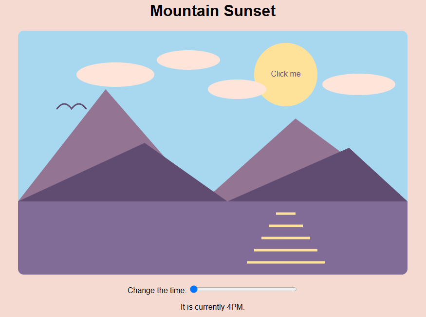
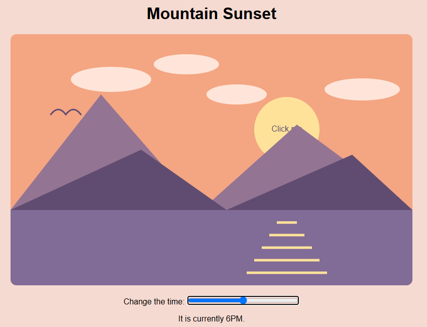

# Assignment 1: Mountain Sunset

## Project Description

I created an interactive mountain sunset using D3.js. The illustration uses the time slider to change the color of the sky as time is changed. In the meanwhile, the position of the sun changes with the time as well. When the user clicks on the sun, the selected scene time will be displayed.

## Live Website

## Technical Achievements

### 4 Kinds of Graphics and Additional Shapes
- A circle was used to draw the sun.
- A rectangle was used to draw the sky and lake.
- Polygons were used to draw mountains.
- Lines were used to draw reflection of sunlight on the lake.
- Ellipses were used to draw the clouds.
- Path was used to draw a bird in the sky

### Interaction: Popup
When the user clicks on the sun, the current time of the illustration would pop up. A "Click Me" is written in the center of the sun, moving its position corresponding to the sun's position.

### Complex implementation: Time slider
The user can change the time of the illustration by moving the time slider. According to what time the user moves the slider to, the color of the sky and position of the sun will move corresponding to that time.

## Design Achievements

### Coordinated Color Palette
I carefully selected each color to create a coordinated landscape.

### Difference in Color

Two different colors were used to draw the front and back mountains to create shadow and distance.

### Changing Sunset
A total of 5 different colors were used to generate the changing color of the sky according to time change.

### Clear Interaction
A "Click me" label and pointer cursor indicate that the sun is interactive. Clicking the sun displays the selected time.

## Sources and Acknowledgments
- D3.js library: https://d3js.org/
- Popup interaction reference:
  https://stackoverflow.com/questions/72822617/how-to-add-popup-on-d3-js-visualization-tree-nodes
  I consulted this discussion for the idea of using
  a D3 click event to trigger a popup
  I used ChatGPT to review if all requirements for the assignment has been met and to review my README.
- ChatGPT also helped me with generating ideas for what could be implemented for complex implementation and how I can do them.
- Lastly, I used ChatGPT to consult code assistance when my code was having an error or not working the way I want to work.

